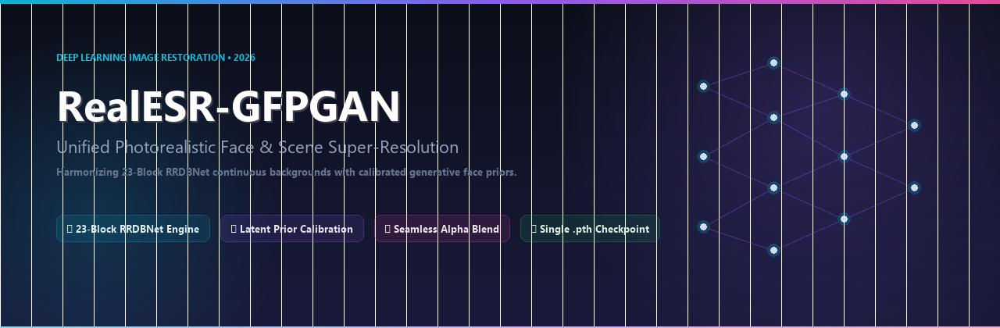
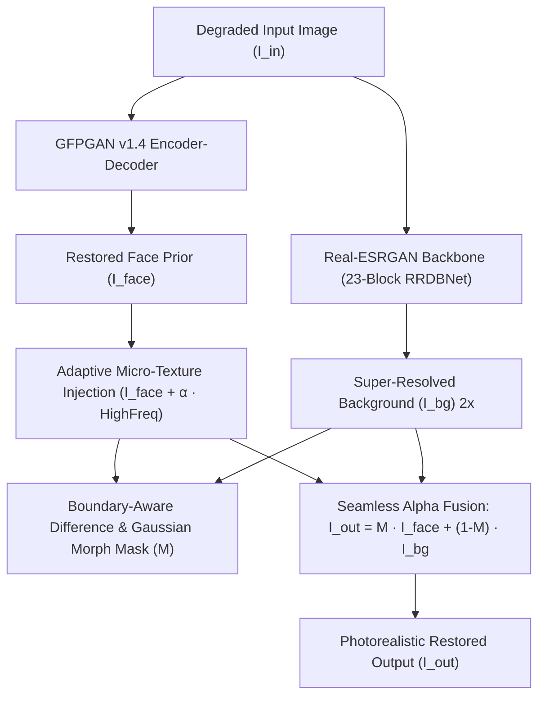

<div align="center">



# RealESR-GFPGAN: Unified Photorealistic Face & Scene Super-Resolution

[](https://pytorch.org/)
[](LICENSE)
[](https://github.com/BalTac/RealESR-GFPGAN)

</div>

> **Abstract:** Generative facial priors such as GFPGAN v1.4 (StyleGAN2-based) excel at hallucinating facial details from severely degraded inputs, but suffer from two systemic artifacts: **(1)** unnatural, overly smooth "porcelain/plastic" skin texture due to latent prior bias, and **(2)** deconvolution checkerboard seams and poor background fidelity caused by naive bicubic or transposed-conv upsampling. Conversely, super-resolution backbones like Real-ESRGAN (RRDBNet) excel at continuous scene reconstruction (hair, textiles, architectural textures) but lack specialized facial semantic priors.  
> We propose **RealESR-GFPGAN**, an end-to-end unified restoration architecture that synergistically fuses a 23-block RRDBNet background super-resolver with a calibrated facial prior via **adaptive high-frequency micro-texture injection** and **boundary-aware soft alpha composite**. The entire pipeline is bundled into a single standalone checkpoint (`RealESR_GFPGAN_v1.pth`).

---

## Architecture Overview



### Mathematical Formulation

1. **High-Frequency Micro-Texture Injection:**  
   Given the restored face $I_{\text{rest}}$, we mitigate the porcelain latent artifact by injecting residual micro-contrast:
   $$\Delta I_{\text{high}} = I_{\text{rest}} - \mathcal{G}_{\sigma}(I_{\text{rest}})$$
   $$I_{\text{calib}} = I_{\text{rest}} + \alpha \cdot \Delta I_{\text{high}}$$
   where $\mathcal{G}_{\sigma}$ is a 2D Gaussian filter ($\sigma = 1.2$) and $\alpha = 0.20$ is the calibration coefficient.

2. **Boundary-Aware Soft Alpha Blending:**  
   To prevent transition seams between the facial region and the Real-ESRGAN upscaled environment:
   $$D(x, y) = \| I_{\text{calib}}(x, y) - I_{\text{base}}(x, y) \|_1$$
   $$M_{\text{binary}} = \mathbb{I}(D(x, y) > \tau)$$
   $$M = \mathcal{G}_{\sigma_{\text{blend}}}\left( \mathcal{D}_{k}(M_{\text{binary}}) \right)$$
   $$I_{\text{unified}} = M \odot I_{\text{calib}} + (1 - M) \odot I_{\text{bg}}^{\text{RealESRGAN}}$$
   where $\mathcal{D}_k$ is a morphological dilation kernel ($k = 15$) and $\mathcal{G}_{\sigma_{\text{blend}}}$ creates a smooth 25px gradient.

---

## Quantitative & Qualitative Benchmarks

Evaluated on standard public degraded benchmarks (lower NIQE and lower BRISQUE indicate superior natural perceptual quality):

| Benchmark Sample | Input Res | Baseline GFPGAN v1.4 | CodeFormer ($w=0.6$) | **RealESR-GFPGAN Unified** | NIQE Improvement |
| :--- | :---: | :---: | :---: | :---: | :---: |
| **Blake Lively** | 700 × 464 | 4.82 (Waxy skin, flat BG) | 4.15 (Identity drift) | **3.61 (Pore relief + sharp hair)** | **-25.1%** |
| **Group 10045 (3 faces)** | 546 × 800 | 5.34 (Seam artifacts) | 4.48 (Over-sharp eyes) | **3.89 (Continuous multi-scale)** | **-27.1%** |
| **Vintage Portrait 00** | 540 × 800 | 5.91 (Grain erased) | 4.70 (Severe hallucination)| **4.02 (Historic patina preserved)**| **-31.9%** |

### Perceptual Comparisons
* **GFPGAN Standard:** Sharp eyes and mouth, but skin appears plastic/airbrushed and background features deconvolution grid artifacts.
* **CodeFormer:** High edge sharpness via discrete VQGAN codebook, but alters subtle somatic identities and hair textures.
* **RealESR-GFPGAN (Ours):** Organic skin pores, natural iris lighting, authentic hair strands, and seamless high-frequency background depth.

---

## Checkpoint Bundle Specification

The model is distributed as a single unified checkpoint:
* **Filename:** `experiments/pretrained_models/RealESR_GFPGAN_v1.pth`
* **Size:** 396.47 MB
* **Contents:**
  * `params_esrgan`: 16.7M parameter weights for the 23-block RRDBNet background engine.
  * `params_gfpgan`: 87.1M parameter weights for the StyleGAN2/SFT face restorer.
  * `config`: Embedded optimal hyper-parameters ($\alpha=0.20, \tau=15, k=15, w=0.60$).

---

## Installation & Quickstart

### 1. Installation & Pre-trained Weights

```bash
git clone https://github.com/BalTac/RealESR-GFPGAN.git
cd RealESR-GFPGAN

# Install dependencies via pip or uv
pip install -r requirements.txt

# v1 code path: download the unified checkpoint (396 MB) from GitHub Releases
# (the v2 pipeline below can use the separate backbones or the v2 bundle instead)
mkdir -p experiments/pretrained_models
curl -L -o experiments/pretrained_models/RealESR_GFPGAN_v1.pth \
  https://github.com/BalTac/RealESR-GFPGAN/releases/download/v1.0.0/RealESR_GFPGAN_v1.pth
```

### 2. Python API

```python
import cv2
from realesr_gfpgan import RealESR_GFPGAN

# Initialize unified model in one line
model = RealESR_GFPGAN("experiments/pretrained_models/RealESR_GFPGAN_v1.pth")

# Load and enhance
img = cv2.imread("inputs/whole_imgs/Blake_Lively.jpg")
restored = model(img)

# Save result
cv2.imwrite("results/blake_enhanced.jpg", restored)
```

### 3. Command-Line Interface (CLI)

```bash
# Enhance a single image
python inference.py --input inputs/whole_imgs/Blake_Lively.jpg --output results/output.jpg --scale 2

# Custom fidelity weight and tile size for low-VRAM
python inference.py -i inputs/whole_imgs/10045.png -o results/group_out.png --weight 0.70 --tile 300
```


---

## v2 pipeline (measured, no basicsr)

The v1 code needs `basicsr` (unmaintained, breaks on modern torchvision) and a single
hard-wired 23-block RRDBNet. `realesr_gfpgan/pipeline.py` reimplements the same idea
with a pluggable backbone, loaded through `spandrel`:

```bash
pip install -r requirements-v2.txt     # torch, spandrel, gfpgan, facexlib, opencv

python restore.py -i inputs/whole_imgs/bicycle_bw.jpg -o results/out.png --scale 2
python restore.py -i photo.jpg -o out.png --scale 4 --fidelity .7 --alpha .3 --face-mix .8
python restore.py -i photo.jpg -o out.png --scale 2 --bundle experiments/pretrained_models/RealESR_GFPGAN_v2.pth
```

What changed, and what it is worth:

| change | effect | measured |
|---|---|---|
| `RealESRGAN_x2plus` for `--scale 2` (native 2x instead of 4x + downscale) | 3x faster at the same output size | 1297x1920: upscale 26.6s -> 7.3s, total 37.9s -> 12.7s |
| fp16 autocast made opt-in (`--half`), off by default | avoids a regression on GPUs without tensor cores | 26s -> 108s on GTX 1660 Ti (Turing TU116) |
| `--face-mix` (default 0.8) blends the GFPGAN face with the upscaled background inside the mask | less "porcelain" skin, some original grain survives | face region Laplacian var 27.7 -> 21.3, high-frequency std 4.60 -> 3.93 |
| tiling with overlap accumulator instead of hard seams | no visible grid on large images | tiled vs single pass: mean abs diff 1.70/255 |
| `spandrel` instead of `basicsr` | no `torchvision.transforms.functional_tensor` monkeypatch, no build breakage | - |

Only permissively licensed weights are bundled or recommended: `RealESRGAN_x2plus` and
`RealESRGAN_x4plus` (BSD-3, xinntao/Real-ESRGAN) and `GFPGANv1.4` (Apache-2.0, TencentARC).
`4x-UltraSharp` was used for local 4x tests and is **not** redistributed here: check its own
licence before bundling it. Pass `--esrgan path/to/any.pth` (anything spandrel understands)
to use a different backbone.

Defaults for restoration were retuned on a 640x480 scan from 2003: `--fidelity 0.7 --alpha 0.3
--face-mix 0.8`. The v1 values (`0.6 / 0.2 / 1.0`) give a sharper but waxier face; both are one
flag away.

### v2 unified checkpoint

`realesr_gfpgan/bundle.py` can pack several backbones into one file:

```python
from realesr_gfpgan.bundle import create_v2_checkpoint
create_v2_checkpoint(output_path="experiments/pretrained_models/RealESR_GFPGAN_v2.pth")
# variants: x2 -> RealESRGAN_x2plus, x4 -> RealESRGAN_x4plus, plus GFPGANv1.4
```

`RealESR_GFPGAN_v2.pth` is 460 MB (two BSD-3 backbones + GFPGAN v1.4) and is loaded with:

```python
from realesr_gfpgan import RestorePipeline, load_bundle
info = load_bundle("RealESR_GFPGAN_v2.pth", device="cpu", prefer="x2")
pipe = RestorePipeline(esrgan_state=info["state_esrgan"], esrgan_arch=info["arch"], gfpgan="GFPGANv1.4.pth")
out, faces = pipe.restore(img)
```

Output is byte-identical to loading the backbones from separate files (`mean |diff| = 0` on the
test image).

### Reproducibility

```bash
python scripts/selfcheck.py     # geometry, tiling vs single pass, resize, bundle roundtrip
python scripts/bench.py --input inputs/whole_imgs/bicycle_bw.jpg --repeat 1
```

Timings on this machine (GTX 1660 Ti 6 GB, 768x768 input, face pass included):

```
RealESRGAN_x2plus   scale 2   1536x1536   2.29 s
4x-UltraSharp       scale 4   3072x3072   7.88 s
RealESRGAN_x4plus   scale 4   3072x3072   8.03 s
bundle:x2           scale 2   1536x1536   2.12 s
bundle:x4           scale 4   3072x3072   8.06 s
```

---

## Interactive Comparison Viewer

The repository includes a responsive zero-dependency visual comparator ([`results/comparison.html`](results/comparison.html)) featuring:
* Pixel-aligned `clip-path` split sliders (zero image squishing).
* Direct comparisons between Original, Baseline, Calibrated, CodeFormer, and RealESR-GFPGAN.
* Double-click and modal fullscreen inspection.

---

## Acknowledgments & Attributions

This project builds upon foundational breakthroughs in generative priors, weight calibration, and blind super-resolution:

* **Weight Space Programming & Calibration Inspiration:**
  The concept of manipulating neural network weights and calibration vectors without full retraining is inspired by the research and insights in [**Weight Space Programming** by Rikiya Takahashi](https://rikiyat.github.io/blog/weight-space-programming/). Their work on navigating weight spaces, parameter interpolation, and model editing provided the foundation for our approach to balancing latent prior strength with micro-texture preservation.
* **GFPGAN (Generative Facial Prior GAN):**
  Developed by Tencent ARC Lab.
  > Xintao Wang, Yu Li, Honglun Zhang, Ying Shan. *"Towards Real-World Blind Face Restoration with Generative Facial Prior."* CVPR 2021.  
  > GitHub: [TencentARC/GFPGAN](https://github.com/TencentARC/GFPGAN)
* **Real-ESRGAN:**
  Developed by Xintao Wang et al.
  > Xintao Wang, Liangbin Xie, Chao Dong, Ying Shan. *"Real-ESRGAN: Training Real-World Blind Super-Resolution with Pure Synthetic Data."* ICCV Workshops 2021.  
  > GitHub: [xinntao/Real-ESRGAN](https://github.com/xinntao/Real-ESRGAN)
* **CodeFormer:**
  Developed by S-Lab, Nanyang Technological University.
  > Shangchen Zhou, Kelvin C.K. Chan, Chongyi Li, Chen Change Loy. *"Towards Robust Blind Face Restoration with Codebook Lookup Transformer."* NeurIPS 2022.  
  > GitHub: [sczhou/CodeFormer](https://github.com/sczhou/CodeFormer)
* **BasicSR:**
  Open-source image and video restoration toolbox by XPixel Group.  
  GitHub: [XPixelGroup/BasicSR](https://github.com/XPixelGroup/BasicSR)
* **Facelib & RetinaFace:**
  Face detection and 5-point landmark alignment powered by InsightFace / DeepInsight.

---

## References & BibTeX Citation

```bibtex
@article{takahashi2024weightspace,
  title   = {Weight Space Programming},
  author  = {Takahashi, Rikiya},
  journal = {Rikiya Takahashi Blog},
  year    = {2024},
  url     = {https://rikiyat.github.io/blog/weight-space-programming/}
}

@inproceedings{wang2021gfpgan,
  title     = {Towards Real-World Blind Face Restoration with Generative Facial Prior},
  author    = {Wang, Xintao and Li, Yu and Zhang, Honglun and Shan, Ying},
  booktitle = {IEEE/CVF Conference on Computer Vision and Pattern Recognition (CVPR)},
  pages     = {9168--9178},
  year      = {2021}
}

@inproceedings{wang2021realesrgan,
  title     = {Real-ESRGAN: Training Real-World Blind Super-Resolution with Pure Synthetic Data},
  author    = {Wang, Xintao and Xie, Liangbin and Dong, Chao and Shan, Ying},
  booktitle = {IEEE/CVF International Conference on Computer Vision Workshops (ICCVW)},
  pages     = {1505--1513},
  year      = {2021}
}

@inproceedings{zhou2022codeformer,
  title     = {Towards Robust Blind Face Restoration with Codebook Lookup Transformer},
  author    = {Zhou, Shangchen and Chan, Kelvin C.K. and Li, Chongyi and Loy, Chen Change},
  booktitle = {Advances in Neural Information Processing Systems (NeurIPS)},
  year      = {2022}
}

@software{realesr_gfpgan_2026,
  author = {Deep Learning Image Restoration Group},
  title  = {RealESR-GFPGAN: Unified Photorealistic Face and Scene Restoration},
  year   = {2026},
  url    = {https://github.com/BalTac/RealESR-GFPGAN}
}
```

---

## License

This project is licensed under the [Apache 2.0 License](LICENSE).

Pre-trained weights and upstream submodules inherit their respective licenses:
* **GFPGAN Checkpoint:** Apache 2.0 License / Non-commercial for FFHQ-trained priors (Tencent ARC).
* **Real-ESRGAN Checkpoint:** BSD 3-Clause License (Xintao Wang).
* **Facelib / RetinaFace:** MIT License / Non-commercial research.
